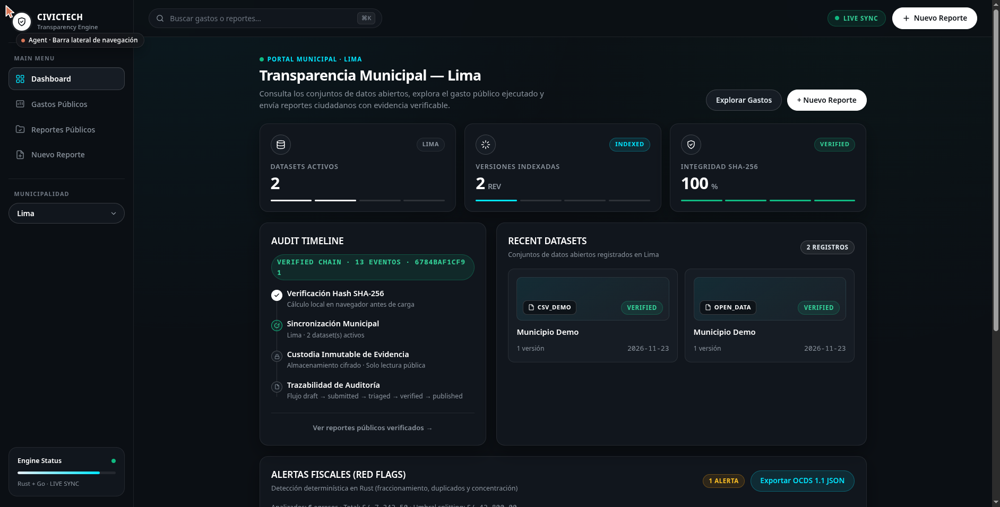

# CivicTech Peru (`estado`)

[](LICENSE)
[-dea584.svg)](https://www.rust-lang.org/)
[-00ADD8.svg)](https://go.dev/doc/)
[](https://tanstack.com/start/latest)
[](https://standard.open-contracting.org/latest/en/)
[](https://spec.openapis.org/oas/v3.1.0)
[-8b5cf6.svg)](https://modelcontextprotocol.io/)

Open-source, **AI-Agent-First** civic tech platform for Peru: public fiscal transparency, cryptographic SHA-256 audit chains, **OCDS 1.1** contracting exports, deterministic **Rust** fiscal red-flag detection, and privacy-preserving citizen whistleblowing with anonymous receipts.

<p align="center">
  
</p>

---

## End-to-End Walkthrough (Zero → Advanced)

Recorded live in native **1440×810 HD** against the complete running stack (**PostgreSQL 16 + RustFS S3 `AES256` + Rust Critical Engine + Go Hexagonal API + Bun/TanStack Start**):

1. **Citizen Portal (`:3000`)**: Live KPIs, cryptographic **Audit Chain (`VERIFIED CHAIN`)**, **Fiscal Red Flags** (`HIGH_ENTITY_CONCENTRATION`), and **OCDS 1.1 JSON** export.
2. **Public Expenses Explorer (`/expenses`)**: Filter by entity, category, or date range with exact integer-cent `PEN` (`S/`) totals (`BigInt`, zero floating-point drift).
3. **Anonymous Citizen Report (`/report`)**: Create draft → optional client-side SHA-256 evidence upload (`AES256`) → submit → receive one-time **Anonymous Receipt Code (`XXXX-XXXX-XXXX-XXXX`)**.
4. **Moderation & Ingest Console (`:3001`)**: In-memory Bearer auth → **Triaje → Verificar → Publicar** with mandatory auditable `reason` & redacted `public_text` → idempotent CSV ingest (`Deduplicado (idempotente)`).
5. **Public Feed & Anonymous Tracker (`/reports`)**: Newly published report live + anonymous tracking via `X-Receipt-Code` showing the full verified lifecycle (`DRAFT → SUBMITTED → TRIAGED → VERIFIED → PUBLISHED`).

<p align="center">
  
</p>

> **Full Native HD Video (1440×810, H.264 High Profile, CRF 18, 3.1 MB)**: [`docs/media/civictech-demo.mp4`](docs/media/civictech-demo.mp4)

### Moderation & Admin Console (`apps/admin`)

<p align="center">
  
</p>

---

## Polyglot Hexagonal Architecture


| Layer | Technology | Port | Responsibility |
| :--- | :--- | :---: | :--- |
| **Critical Domain Engine** (`crates/*`) | [Rust](https://doc.rust-lang.org/) (Axum, `sha2`, `csv`) | `:8090` | Deterministic report state machine, pure exact-cents (`i64`) CSV ingest, length-prefixed SHA-256 **Audit Hash Chain**, and exact `i64`/`i128` **OCDS Fiscal Red-Flag** rules |
| **Backend HTTP API** (`services/api`) | [Go 1.24](https://go.dev/doc/) (`net/http`, `pgx/v5`, AWS SDK v2) | `:8080` | Hexagonal ports/adapters, `municipality_id`-scoped Postgres queries, transactional hash-chained `audit_events`, OIDC JWKS (`singleflight` + cooldown), RustFS `AES256` presigned URLs, per-IP `429` rate limiter, OCDS 1.1 export, and AI-First discovery |
| **Citizen Web App** (`apps/web`) | [Bun](https://bun.sh/docs) + [TanStack Start](https://tanstack.com/start/latest) | `:3000` | Dark Obsidian transparency portal (`packages/tokens/tokens.json`), exact `BigInt` PEN formatting, browser SHA-256 uploads, anonymous receipt banner & tracker, `/llms.txt` |
| **Moderation Console** (`apps/admin`) | [Bun](https://bun.sh/docs) + [TanStack Start](https://tanstack.com/start/latest) | `:3001` | Scope-isolated moderation queue (`Triaje`/`Verificar`/`Rechazar`/`Publicar`), in-memory Bearer token auth, idempotent CSV ingest console |
| **MCP Server** (`services/mcp`) | [MCP](https://modelcontextprotocol.io/) (Bun + strict TypeScript) | `stdio` | JSON-RPC 2.0 server exposing **13 typed tools** for AI agents with HTTPS non-loopback enforcement and explicit DTO projection |
| **Data & Storage** (`infra/`) | [PostgreSQL 16](https://www.postgresql.org/docs/16/), [RustFS S3](https://docs.rustfs.com/), Redis 7, Keycloak, Grafana | `:5432` / `:9000` / `:3002` | Migrations `0001`–`0004`, enforced default `AES256` bucket encryption, OIDC realm, Prometheus & Grafana dashboards |

---

## AI-Agent-First Discovery & MCP Tools

### Machine-Readable Discovery Endpoints (`http://localhost:8080`)
- `GET /openapi.json` — Live [OpenAPI 3.1.0](https://spec.openapis.org/oas/v3.1.0) specification covering all public, citizen, moderation, and admin endpoints.
- `GET /llms.txt` & `http://localhost:3000/llms.txt` — Concise agent operational guides (state machine, auth, exact-cent rules, `data-testid` map).
- `GET /.well-known/agent.json` — Structured agent capability manifest (auth modes, `Idempotency-Key`, `X-Receipt-Code`, lifecycle transitions).
- `GET /public/ocds/releases.json?municipality_id=lima` — [OCDS 1.1](https://standard.open-contracting.org/latest/en/) contracting release package with exact `json.Number` amounts.
- `GET /public/audit/verify` — Live cryptographic audit hash-chain verification via Rust engine.
- `GET /public/anomalies?municipality_id=lima` — Deterministic fiscal red flags (`CONTRACT_SPLITTING`, `DUPLICATE_DISBURSEMENT`, `HIGH_ENTITY_CONCENTRATION`).

### MCP Server (`services/mcp` — 13 Typed Tools)
Run over stdio for Claude, Pi, Cursor, or Codex:
```bash
CIVICTECH_API_URL=http://127.0.0.1:8080 bun run services/mcp/src/index.ts
```
- **Public & Transparency**: `list_datasets`, `query_expenses`, `list_public_reports`, `get_public_report`, `verify_audit_chain`, `detect_spending_anomalies`, `export_ocds_releases`
- **Citizen Reporting**: `create_report` (supports `Idempotency-Key`, returns one-time `receipt_code`), `submit_report`, `track_report_by_receipt` (`X-Receipt-Code`)
- **Moderation & Admin** (requires `CIVICTECH_API_TOKEN`): `list_moderation_cases`, `moderate_case`, `run_demo_ingest`

---

## Security, Privacy & Audit Guarantees

- **Zero Floating-Point Money or Percentages**: Rust uses `i64`/`i128`, Go uses `int64` + `json.Number`, TypeScript uses `Number.isSafeInteger` + `BigInt`.
- **Cryptographic Audit Trail**: Every mutation on reports, evidence, or ingest writes a transactional `audit_events` row chained via length-prefixed SHA-256 (`prev_hash → event_hash`) verified by `crates/audit`.
- **Strict State Machine**: `DRAFT → SUBMITTED → TRIAGED → VERIFIED → PUBLISHED` (or `REJECTED`), enforced deterministically in Rust; invalid transitions return `422` with `allowed_actions`.
- **Privacy & Whistleblower Protection**: Public endpoints omit internal `storage_ref`, `sha256`, and `report_id` (exposing `evidence_count` only); anonymous `receipt_code` is stored solely as SHA-256 and never logged; error responses are sanitized.
- **Zero Hardcoded Secrets**: All credentials are env-required (including `infra/docker-compose.yml` and CI ephemeral masked secrets); `evidence` bucket enforces default `AES256` encryption at rest.
- **Multi-Tenant Scoping & Resilience**: Every query scopes by `municipality_id`; OIDC JWKS uses `singleflight` coalescing + unknown-`kid` cooldown; public write/track endpoints enforce per-IP `429` rate limiting and SHA-256 payload-bound `Idempotency-Key` (`409`).

---

## Quick Start (Local Development)

1. **Configure local environment** (copy `configs/env.example` to `.env` and fill local secrets):
   ```bash
   cp configs/env.example .env
   ```
2. **Start infrastructure (PostgreSQL 16 + RustFS S3 `AES256`) and apply migrations + seed**:
   ```bash
   make infra-up && make migrate && make seed
   ```
3. **Start all services together** (Rust Engine `:8090`, Go API `:8080`, Web `:3000`, Admin `:3001`):
   ```bash
   make dev
   ```
4. **Run the complete quality gate** (strict TypeScript, Bun tests, Vite client+SSR builds, Go `gofmt`/`go vet`/`go test -race`/`go build`, Rust `cargo fmt`/`clippy -D warnings`/`cargo test`):
   ```bash
   bun run quality:check
   cd services/mcp && bunx tsc --noEmit && bun test
   ```
5. **Run live DB-audited smoke tests** (verifies RBAC, 422 transitions, cross-tenant 404s, and parameterized `audit_events` invariants in Postgres):
   ```bash
   bun run smoke:e2e
   bun run smoke:workflow-b
   bun run smoke:rbac
   ```

---

## Documentation & Official References
- **Project Docs**: [`docs/README.md`](docs/README.md) · [`docs/VISION.md`](docs/VISION.md) · [`docs/ARCHITECTURE/OVERVIEW.md`](docs/ARCHITECTURE/OVERVIEW.md) · [`AGENTS.md`](AGENTS.md) · [`SECURITY.md`](SECURITY.md) · [`CONTRIBUTING.md`](CONTRIBUTING.md)
- **Standards & Specs**: [Open Contracting Data Standard (OCDS 1.1)](https://standard.open-contracting.org/latest/en/) · [OpenAPI 3.1](https://spec.openapis.org/oas/v3.1.0) · [Model Context Protocol (MCP)](https://modelcontextprotocol.io/) · [TanStack Start](https://tanstack.com/start/latest) · [Rust](https://doc.rust-lang.org/) · [Go](https://go.dev/doc/) · [RustFS Encryption](https://docs.rustfs.com/en/security-compliance/encryption)
- **License**: [MIT](LICENSE)
