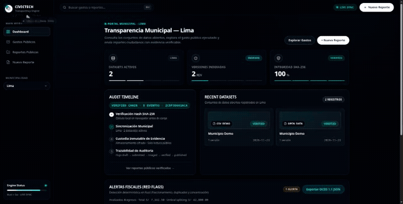
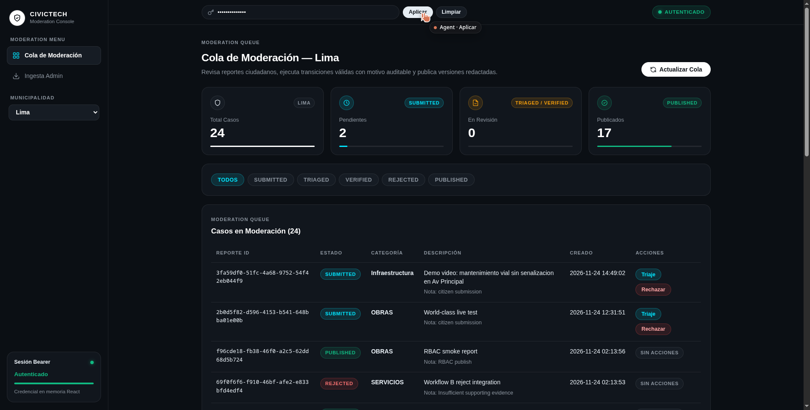

# CivicTech Peru (`estado`)

Open-source, **AI-Agent-First** civic tech platform for Peru: public fiscal transparency, cryptographic audit chains, OCDS 1.1 contracting exports, deterministic fiscal red-flag detection, and privacy-preserving citizen whistleblowing.

<p align="center">
  
</p>

## Live End-to-End Walkthrough (Zero → Advanced)

Recorded directly with `ego-browser` running against the full live stack (**Postgres 16 + RustFS S3 `AES256` + Rust Critical Engine + Go Hexagonal API + Bun/TanStack Start**):
1. **Citizen Portal (`:3000`)**: KPIs, live cryptographic **Audit Chain (`VERIFIED CHAIN`)**, **Fiscal Red Flags**, and **OCDS 1.1 JSON** export.
2. **Public Expenses Explorer (`/expenses`)**: category filtering with exact integer-cent `PEN` (`S/`) totals.
3. **Anonymous Citizen Report (`/report`)**: draft creation → submission → one-time **Anonymous Receipt Code (`XXXX-XXXX-XXXX-XXXX`)**.
4. **Moderation & Ingest Console (`:3001`)**: Bearer auth → **Triaje → Verificar → Publicar** with auditable reason & redacted public text → idempotent CSV ingest (`Deduplicado (idempotente)`).
5. **Public Feed & Anonymous Tracker (`/reports`)**: newly published report live + anonymous tracking via `X-Receipt-Code` showing `DRAFT → SUBMITTED → TRIAGED → VERIFIED → PUBLISHED`.

<p align="center">
  
</p>

- **Full HD Video (1280×650 H.264 MP4)**: [`docs/media/civictech-demo.mp4`](docs/media/civictech-demo.mp4)

### Moderation & Admin Console (`apps/admin`)

<p align="center">
  
</p>

---

## Polyglot Architecture (Go + Rust + Bun/TanStack Start + MCP)


- **Rust Critical Engine (`crates/audit`, `crates/domain`, `crates/ingest`, `crates/engine`, `:8090`)**:
  - Bearer-authenticated internal HTTP service with zero floating-point money/percentages (`i64`/`i128`).
  - Deterministic report lifecycle state machine (`DRAFT → SUBMITTED → TRIAGED → VERIFIED → PUBLISHED` / `REJECTED`).
  - Pure CSV expense parser with exact `amount_cents`, strict `YYYY-MM-DD` validation, and SHA-256 checksums.
  - Length-prefixed SHA-256 **Cryptographic Audit Hash Chain** (`compute_event_hash`, `verify_chain`).
  - Deterministic **OCDS Fiscal Red-Flag Engine** (`CONTRACT_SPLITTING`, `DUPLICATE_DISBURSEMENT`, `HIGH_ENTITY_CONCENTRATION`).
- **Go Hexagonal Backend API (`services/api`, `:8080`)**:
  - Parameterized `pgxpool` PostgreSQL store scoped by `municipality_id`, transactional hash-chained `audit_events`, and race-safe idempotent ingestion (`pg_advisory_xact_lock` + `ON CONFLICT`).
  - **Anonymous Whistleblower Receipts**: one-time `receipt_code` (stored only as SHA-256) + PII-free `GET /public/reports/track` via `X-Receipt-Code`.
  - **OCDS 1.1 Export** (`GET /public/ocds/releases.json`), **Audit Chain Verification** (`GET /public/audit/verify`), and **Fiscal Red Flags** (`GET /public/anomalies`).
  - **RustFS S3 (`:9000`)** presigned uploads with enforced `AES256` server-side encryption, MIME allowlist, and mandatory `size_bytes` (`1 B – 10 MiB`).
  - Hardened OIDC JWKS auth (`singleflight` coalescing + unknown-`kid` refresh cooldown + fail-closed issuer/audience), per-IP `429` rate limiting, and SHA-256 payload-bound `Idempotency-Key` (`409` on mismatch).
- **Frontends (`apps/web` `:3000`, `apps/admin` `:3001`)**:
  - **Bun + TanStack Start** in strict TypeScript (zero `any`, zero `console.log`, `BigInt` currency & percentages, runtime response decoders).
  - CivicTech **Dark Obsidian Design System** (`packages/tokens/tokens.json`) with desktop sidebar + responsive mobile bottom navigation.
  - Agent-ready DOM semantics (`data-testid`, `data-state`, `data-status`, `data-deduplicated`, `aria-live="polite"`) and `apps/web/public/llms.txt`.
- **AI-Agent-First Discovery & MCP Server (`services/mcp`)**:
  - Live API discovery: `GET /openapi.json` (OpenAPI 3.1), `GET /llms.txt`, `GET /.well-known/agent.json`.
  - Bun TypeScript **MCP (Model Context Protocol, JSON-RPC 2.0 over stdio)** server exposing **13 typed tools** (`list_datasets`, `query_expenses`, `list_public_reports`, `get_public_report`, `create_report`, `submit_report`, `track_report_by_receipt`, `verify_audit_chain`, `detect_spending_anomalies`, `export_ocds_releases`, `list_moderation_cases`, `moderate_case`, `run_demo_ingest`).

---

## Repo Layout
- `crates/`: Rust critical engines (`domain`, `audit`, `ingest`, `verify`, `engine`, `observability`)
- `services/api/`: Go hexagonal HTTP API (`cmd/api`, `internal/{domain,ports,adapters,auth,httpapi}`)
- `services/mcp/`: Bun TypeScript MCP server (13 typed AI-agent tools)
- `apps/web/` & `apps/admin/`: Bun + TanStack Start frontends (Dark Obsidian UI)
- `packages/tokens/`: Design tokens (`tokens.json`)
- `infra/`: `docker-compose.yml` (Postgres 16, RustFS S3 `AES256`, Redis 7, Keycloak, Prometheus, Grafana `:3002`), SQL migrations `0001`–`0004`, seeds
- `docs/`: Architecture, ADRs, RFCs, MVP specs, diagrams, and demo media (`docs/media/`)

## Run Locally
1. Copy `configs/env.example` to `.env` and fill local secrets (`POSTGRES_PASSWORD`, `MINIO_ROOT_PASSWORD`, `RUSTFS_SSE_S3_MASTER_KEY`, `KEYCLOAK_*`, `GF_SECURITY_ADMIN_PASSWORD`, `ENGINE_INTERNAL_TOKEN`, `AUTH_DEV_ADMIN_TOKEN`, `AUTH_DEV_MODERATOR_TOKEN`).
2. Start infra & run migrations + seed:
   ```bash
   make infra-up && make migrate && make seed
   ```
3. Start the full stack (Rust Engine `:8090`, Go API `:8080`, Web `:3000`, Admin `:3001`):
   ```bash
   make dev
   ```
4. Run full quality suite (TypeScript strict typecheck, Bun unit tests, Vite client+SSR builds, Go `gofmt`/`go vet`/`go test`/`go build`, Rust `cargo fmt`/`clippy -D warnings`/`cargo test`):
   ```bash
   bun run quality:check
   cd services/mcp && bunx tsc --noEmit && bun test
   ```
5. Run live DB-audited smoke tests:
   ```bash
   bun run smoke:e2e
   bun run smoke:workflow-b
   bun run smoke:rbac
   ```
6. Run the MCP Server for AI agents:
   ```bash
   CIVICTECH_API_URL=http://127.0.0.1:8080 bun run services/mcp/src/index.ts
   ```

## Principles & Documentation
- Non-partisan, public-interest, auditability by default, privacy & data minimization, open standards (OCDS 1.1, OpenAPI 3.1, MCP).
- Docs index: `docs/README.md` · Vision: `docs/VISION.md` · Architecture: `docs/ARCHITECTURE/OVERVIEW.md` · Security: `SECURITY.md` · Contributing: `CONTRIBUTING.md` · License: `MIT` (`LICENSE`).
